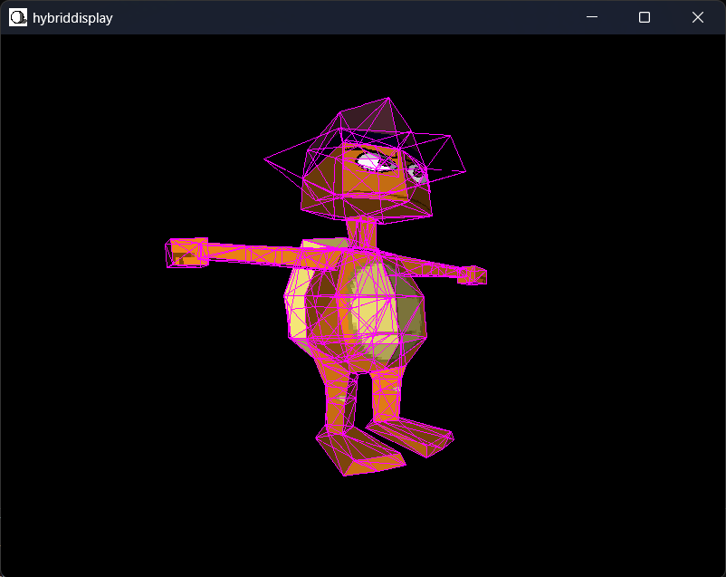
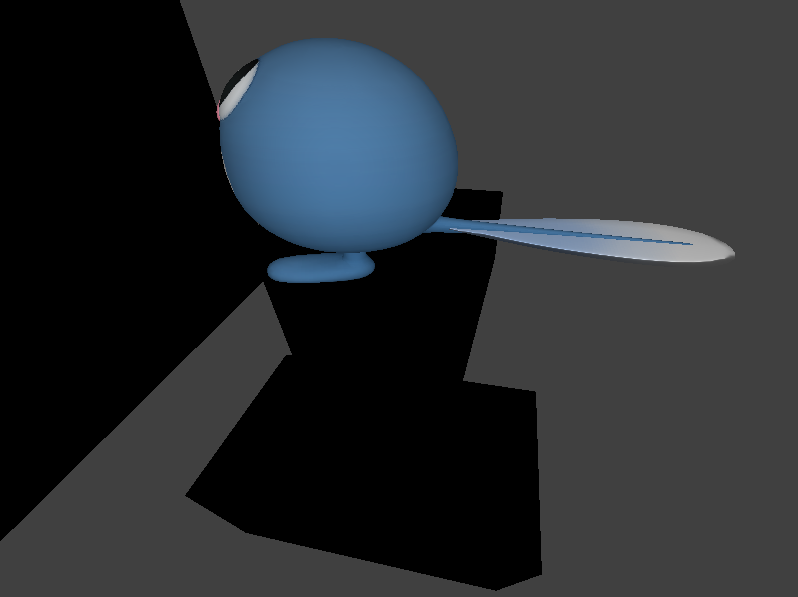
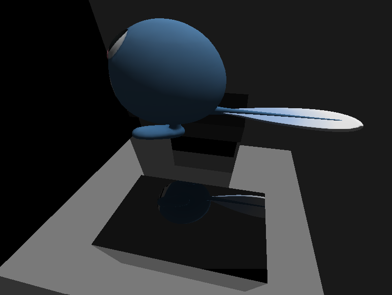
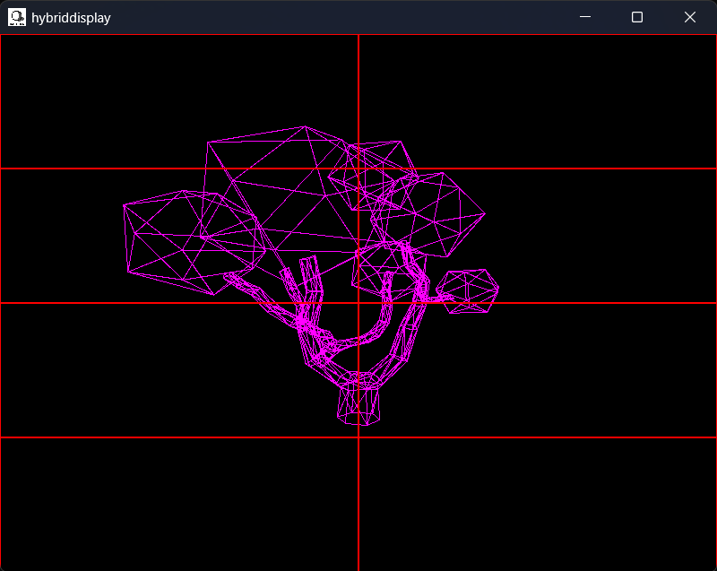
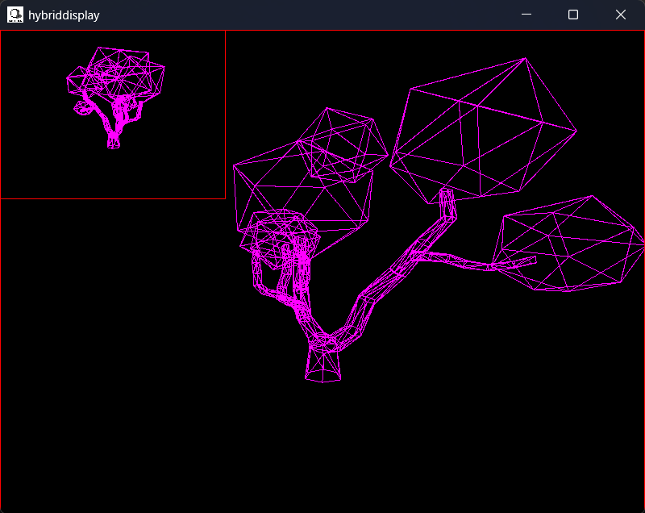
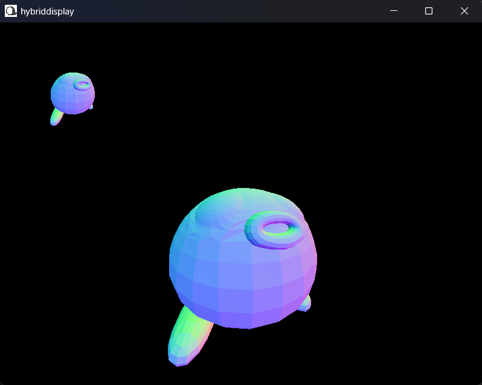
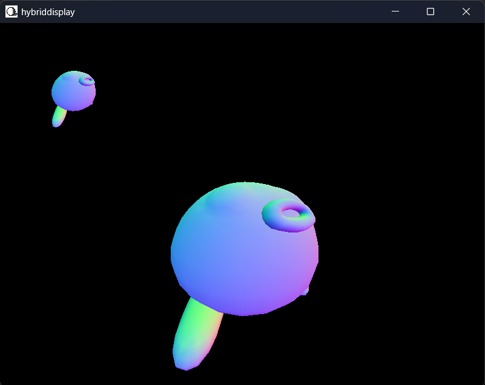

#  hybriddisplay

Started: August 8th, 2026  

## 📝 About
hybriddisplay is a C++26 CPU rasterizer/raytracing hybrid rendering engine. It is the successor to <a href="https://github.com/pearson-kai/superdisplay">superdisplay</a>. Below you can find some of the features first seen in superdisplay, and the additions to those features that will come in hybriddisplay.

| superdisplay | hybriddisplay |
|----------|------------|
| Full perspective CPU rasterization | CPU rasterization and ray tracing options |
| .obj file compatability | Multithreaded rendering (with load balancing) |
| Modular screen options and rendering settings | Textures and normal mapping |
|   | Mesh normal interpolation |
|   | Viewport camera options |
|   | Lambert diffuse lighting |

## ⚙️ Architecture

### Namespaces

All source code for hybriddisplay is organized in 6 namespaces, all under the `hybriddisplay::` parent namespace.

| Namespace | Responsibility |
|----------|------------|
| `math::` | Vec3 and Transform classes. |
| `graphics::` | Materials, colours, and texture mapping. |
| `geometry::` | Vertex, triangle, and mesh storage. |
| `display::` | Wrapper for SDL3 window and texture uploading. |
| `rendering::` | Rendering and pixel painting functions. |
| `threading::` | Multithreading managment objects and functions. |

### Threading

One of the core features of hybriddisplay over superdisplay is the addition of multithreading. To prevent repeaded thread creation and deletion, threads are usually created at the start of the program and stored into a Pool class. The hope is that when there are large chunks of work to be done, tasks can be fed into the Pool, performed, and then the threads in the Pool can go back to sleep.

Much of this is done with lambda functions, where regular function calls are replaced with no argument, conditionally disabled functions. This stems from the fact that all functions that we pass into our Pool have to have the same signature. In this case, we work to make that function signature `std::function<void()>`.

A function like `void foo(int value, Object& obj);` can be turned into a no arg lambda function like this:

- `std::function<void()> fooLambda = [myObj&](){ foo(12,myObj); };`
- `fooLambda();`

And then we can pass that into a queue, where threads that are asleep can wake up and perform the job. This is convenient for tasks like model transforms, and expensive draw calls. When rendering a frame we split up the number of vertices in a model based on the number of threads we have in our pool, and allocate space for each thread to be able to write to an array. Threads perform the vertex transformation math and write their results in their allocated memory. 

Performing actions with Pool does contain overhead: each function call from the queue comes with it's own Mutex work, but being able to chop a single expensive function into multiple cheaper functions to have multiple cores in your CPU work on has cut frame time dramatically. 

### Rendering

The rendering code can be found in `src/Renderer.cpp`, where you can see different implimentations such as wireframe, rasterize, and raytrace. As development of this project continues, more of these functions will have proper implimentations.

One of the core goals for hybriddisplay is having a flexible and dynamic rendering pipeline. With the different rendering options, you can effectively layer effects on top of each other.

Consider a pipeline like this:
1. clearBuffer()
2. rasterize(viewport, camera, world)
3. clearZBuffer()
4. wireframe(viewport, camera, world)
5. presentFrame()

In this pipeline, a Terry the Turtle is rasterized, and a wireframe of Terry is being presented after. Because we clear the z-buffer though between rasterizing and presenting the wireframe, the wireframe will have "priority" over the rasterization, giving an xray look to Terry. This kind of trick can be used to outline him or give an x-ray look, or for general debugging.

Rendering functions are passed 3 things:
- Viewports (pointer to the screen with necessary buffers, and boundaries to print in)
- Camera (scene transform information)
- World (collection of models and light sources)

<table>
  <tr>
    <th align="center">Poliwag Rasterized Render</th>
    <th align="center">Poliwag Raytraced Render</th>
  </tr>
  <tr>
    <td align="center"></td>
    <td align="center"></td>
  </tr>
</table>

### Display (SDL3 Integration)

This project uses SDL3's `SDL_Window` and `SDL_Texture` objects to display graphics. All implimentation code tied to SDL3 can be found in `src/Screen.cpp`. 

The general flow of information to the screen takes place from the frame buffer. The frame buffer in the `display::Screen` class is a vector of colours, the same size as the `SDL_Window`. The `graphics::Colour` consists of 4 uint8_t values: r, g, b, a. When the screen is ready to present something, the frame buffer is copied into an `SDL_Texture`, which is an optimized data structure specifically designed to then connect and display itself in the `SDL_Window`.

### Display (Viewports)

hybriddisplay doesn't render directly to Screen objects though, it renders through viewports. A viewport is defined by a normalized area on the screen with a normalized rendering area from the camera. Viewports are also tied to a Screen, where they paste pixels. This solution allows viewports to display any part of what the camera sees to any part of the screen.

<table>
  <tr>
    <th align="center">Multithreaded Tiled Render Example</th>
    <th align="center">Multiple Viewport Render Example</th>
  </tr>
  <tr>
    <td align="center"></td>
    <td align="center"></td>
  </tr>
</table>

This setup allows for multiple helpful features:
1. Clear seperation of work between threads. While not enforced, viewports aren't meant to overlap between individual rendering calls. What this means is that threads can pickup draw calls for a viewport and render to the screen without interfering with another. This helps enable multithreaded rendering without needing mutexes for each pixel.  
2. Versitile rendering layouts. As you can see in the **Multiple Viewport Render Example**, two angles of the same tree are pasted to the screen, with one being tucked into the left corner. This kind of versitility is important for rendered GUI or HUD assets, such as a minimap or preview of an item in a menu.

### Geometry 

Geometry in hybriddisplay is made up of a few important classes and structures:
1. Vertices
2. Triangles
3. Meshes

The most primative geometric struct in hybriddisplay is the vertex. Vertices are made of a position, normal, and UV Vec3. Position defines where they are, normals define how light bounces off them, and the UV coordinates define where textures should be placed.

Triangles are the next step up since they are the most basic geometric shape. They are made of 3 vertices and a pointer to a material. Triangle also has a method called `getNormal()`, which returns the normal of the face of the triangle. The winding order of triangle vertices is counter clockwise.

The most abstracted data structure in geometry is the mesh. A mesh is a vector of vertices, with an additional vector of indices to rebuild triangles. This way, individual vertices that are used multiple times don't take up extra memory. The same principle is applied to materials. Meshes have access to pointers of each of the materials they use, and material usage is indexed for each triangle.

Meshes are instanciated using Wavefront .obj model files. Alongside this, since Meshes can be extremely resource intensive, meshes are one of the asset cached classes in hybriddisplay. Meshes being asset cached means that you often won't make a new instance of a mesh, rather use a pointer to the same mesh multiple times. To prevent users from needing to keep track of in use meshes, smart pointers are used. `AssetCache.cpp` stores hash maps of all loaded meshes with weak pointers. When there are no references to a particular mesh, it gets removed from memory. If it ever needs to be loaded again, the asset cache can instanciate a new mesh.

A mesh can be loaded into memory as seen below:

`std::shared_ptr<geometry::Mesh> myMesh = geometry::Mesh::load(fs::path("folder/my_mesh.obj"));`

This being said, you often won't want to instanciate a pointer to the mesh you load. Instead, most meshes get wrapped into a model regardless. Models contains a mesh pointer, alonside a transform (translation, rotation, scale). Models cost very little to store, so you can store many models of the same mesh. A model can be loaded with a mesh path automaticall using the code below:  

`mainWorld.addModel(geometry::Mesh::load(fs::path("folder/my_mesh.obj"));, math::Transform());`

<table>
  <tr>
    <th align="center">Triangle Face Normals</th>
    <th align="center">Interpolated Normals</th>
  </tr>
  <tr>
    <td align="center"></td>
    <td align="center"></td>
  </tr>
</table>

`geometry::Mesh::load()` has a second parameter *interpolateNormals* which is defaulted to false. Often, .obj models can come without vertex normals which help define the smoothness of a texture. By default, the normal is set to 0,0,0, which is problematic for lighting functions that require normals. Most lighting models can default back to triangle face normals, but by setting *interpolateNormals* to true, it creates an artificial normal made of the average normal of all triangles the vertex is connected to. It should be noted though that with complicated and poor geometry, this can create unwanted results and strange lighting artifacts. That being said, this can also help fix older models that don't come equipped with vertex normals.

## 📩 Contact
Author: Kai Pearson  
Email: kaipearson@dal.ca  
GitHub: pearsonkai  
